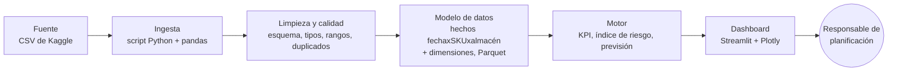
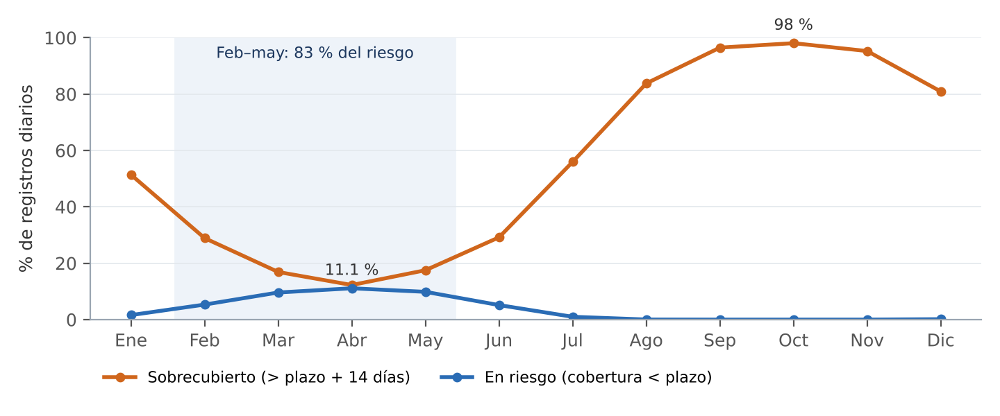
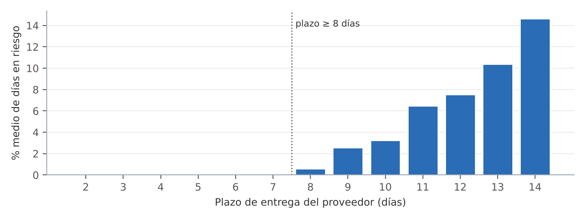

# Project brief: priorización de reposiciones en una red de almacenes

## 1. Resumen ejecutivo

Cada lunes, la herramienta indica a la responsable de planificación qué combinaciones producto-almacén revisar primero y por qué. No hace pedidos.

Hallazgos (datos de 2024):

| Hallazgo | Qué hacer |
|---|---|
| En primavera (febrero a mayo) se vende casi 3 veces más que en septiembre, pero el stock no sube, y ahí cae el 83 % de los días con riesgo. | Más margen de seguridad y revisiones antes de primavera. |
| De agosto a diciembre sobra stock, con más del 80 % de los registros de cada mes por encima del plazo + 14 días de cobertura. | Aplazar reposiciones en otoño y liberar capital. |
| El punto de pedido actual ignora el plazo del proveedor y no marca el 69 % de los días en que el stock no llega a cubrirlo, casi todos con plazos de 8 días o más. | Revisar primero esas combinaciones. |

Son resultados exploratorios, pendientes de las pruebas formales.

## 2. Dataset y calidad de los datos

### Ficha del dataset

| Campo | Información |
|---|---|
| Nombre | High-Dimensional Supply Chain Inventory Dataset |
| Publicador y enlace | Ziya07, Kaggle: https://www.kaggle.com/datasets/ziya07/high-dimensional-supply-chain-inventory-dataset |
| Licencia | CC0 1.0 Universal (dominio público): https://creativecommons.org/publicdomain/zero/1.0/ |
| Fecha de descarga y versión | Descargado el 13/10/2026. Kaggle no muestra fecha de última actualización e indica una frecuencia anual. |
| Qué representa una fila | Un registro por fecha, producto (`SKU_ID`) y almacén (`Warehouse_ID`). |
| Periodo | del 01/01/2024 al 30/12/2024. |
| Tamaño | 91.250 filas x 15 columnas; 6,55 MB. 50 SKU x 5 almacenes = 250 combinaciones, presentes todos los días (250 x 365 = 91.250). 10 proveedores y 4 regiones. |
| Columnas principales | Fecha: `Date`. Dimensiones: `SKU_ID`, `Warehouse_ID`, `Supplier_ID`, `Region`. Medidas: `Units_Sold`, `Inventory_Level`, `Supplier_Lead_Time_Days`, `Reorder_Point`, `Order_Quantity`, `Unit_Cost`, `Unit_Price`, `Demand_Forecast`. Indicadores: `Promotion_Flag`, `Stockout_Flag`. Objetivo candidato: `Units_Sold` (regresión). |
| Calidad observada | 0 % nulos; 0 duplicados; la clave fecha-SKU-almacén es única. Proveedor, plazo, `Reorder_Point` y coste son constantes por combinación. `Stockout_Flag` vale 0 en el 100 % de las filas. `Region` cambia de un día a otro dentro de la misma combinación (las 250 aparecen en las 4 regiones), así que no describe el almacén. El pronóstico (`Demand_Forecast`) de cada día tiene una correlación de 0,95 con las ventas de ese mismo día y de 0,61 con las del día anterior o siguiente. Unidades y moneda de `Unit_Cost` y `Unit_Price` sin documentar. No hay valores imposibles; los outliers por IQR (1,3 % de los días) y Mahalanobis (48 filas) se marcan, no se borran. |
| Otras fuentes | Ninguna unida en esta versión. Candidatas: (1) el calendario de promociones de Ventas, para revisar la reposición antes de cada promoción (H3); (2) los pedidos y recepciones del ERP, para medir plazos y roturas reales y validar H2. Se valoró el calendario de festivos de 2024 (BOE), pero se descartó: la venta media es la misma todos los días de la semana (entre 20,0 y 20,1 unidades). |

### Limitaciones y efecto en la decisión

- **Datos simulados.** Los 50 SKU comparten la misma curva estacional (correlación >= 0,99). Las cifras no se pueden extrapolar a una empresa real.
- **Un solo año.** No muestra si la estacionalidad se repite, así que la validación será temporal dentro de 2024.
- **Faltan datos operativos.** Sin pedidos pendientes, capacidad ni costes, la herramienta prioriza pero no calcula cantidades óptimas. En uso real haría falta el ERP.
- **Posible fuga en `Demand_Forecast`.** La correlación no la demuestra, pero no se usará en el bloque 3 hasta descartarla.

## 3. Problema empresarial

**Organización.** Distribuciones Sago Packaging, mayorista que abastece a comercios desde 5 almacenes, con 50 referencias y 10 proveedores.

**Estrategia.** La empresa quiere mantener el servicio sin aumentar el capital inmovilizado en stock. El proyecto lo apoya desde planificación, reponiendo solo cuando hace falta.

**Departamento.** Planificación de inventario, tres personas que deciden qué reponer en cada almacén.

**Stakeholder.** La responsable de planificación, que revisa el dashboard los lunes. Puede adelantar o aplazar pedidos, pedir transferencias entre almacenes y revisar con Ventas una promoción. No puede cambiar precios, proveedores ni capacidad.

**Decisión.** La responsable decidirá cada semana qué combinaciones revisar primero y qué reposiciones adelantar o aplazar.

**Restricciones.** Proyecto individual, sin ERP ni costes.

**Alternativas sin datos.** (1) Un Excel que avisa cuando `Inventory_Level` < `Reorder_Point`. Es barato, pero ignora el plazo y la estacionalidad. Será la **línea base** con la que se compara la herramienta (H2). (2) Recuentos físicos, que no anticipan nada.

**Efecto en otras áreas.**
- **Compras:** adelanta pedidos a proveedores de plazo largo antes de primavera.
- **Almacén:** más entradas en primavera y menos stock parado en otoño.
- **Finanzas:** menos capital inmovilizado de agosto a diciembre.
- **Ventas:** comparte con antelación el calendario de promociones.
- **Clientes:** menos pedidos incompletos en temporada alta.

## 4. Hipótesis

**Cobertura (días)** = `Inventory_Level` / venta media de esa combinación en los 28 días anteriores (mínimo 7). Si no es calculable, no cuenta. Los umbrales son propios del proyecto y salen de la exploración. Se probarán formalmente en las lecciones 03 a 05. Prioridad por valor: H2 > H1 > H3.

| | **H2 (prioridad alta)** | **H1 (prioridad alta)** | **H3 (prioridad media)** |
|---|---|---|---|
| Enunciado | El criterio cobertura < plazo prioriza casos distintos de la regla de `Reorder_Point`, que ignora el plazo (r = 0,03). | El riesgo se concentra en los meses de demanda alta: inventario y `Reorder_Point` no siguen la temporada. | Las promociones aumentan las ventas de forma relevante. |
| Métrica | % de registros con cobertura < plazo que la regla de `Reorder_Point` no marca. | % de registros en riesgo que caen entre febrero y mayo. | Uplift = media con promoción / media sin promoción - 1. |
| Dirección esperada | Más del 30 %, concentrado en combinaciones con plazo >= 8 días. | Más del 60 %. | Más del 15 %, estable entre meses. |
| Cómo se comprueba | Tabla cruzada de ambas reglas por proveedor y plazo. | Riesgo y demanda por mes, gráfico de líneas. | Medias con y sin promoción por SKU-almacén y mes; se excluyen las 151 combinaciones-mes sin ambos casos y se agrega por SKU-almacén (250 pares): mediana y % de pares positivos. |
| Si es cierta | El motor combina ambas reglas. Sin roturas reales (`Stockout_Flag` = 0) no se sabe cuál acierta más. | Más stock en primavera y menos en otoño. | Usar el calendario de promociones de Ventas para revisar antes la reposición. |
| Si es falsa | La regla de Excel basta: dashboard descriptivo. | Un margen único para todo el año. | No ajustar la reposición por promoción. |

En H3, la diferencia no prueba que la cause la promoción.

## 5. Indicadores del dashboard

| KPI | Fórmula | Grano | Comparación | Objetivo | Hipótesis |
|---|---|---|---|---|---|
| Demanda media diaria | Suma de `Units_Sold` / días (ventana de 28 días) | SKU-almacén, día | Almacén, mes | Contexto | H1 |
| % de registros en riesgo | Registros con cobertura < plazo / registros evaluados | Día | Almacén, proveedor | <= 2 % (actual: 3,7 %) | H2 |
| % de registros en banda | Registros con plazo <= cobertura <= plazo + 14 días / registros evaluados | Día | Almacén, mes | >= 70 % (actual: 41 %) | H1, H2 |
| % de registros bajo punto de pedido | Registros con `Inventory_Level` < `Reorder_Point` / registros evaluados | Día | Almacén | Línea base (actual: 5,3 %) | H2 |
| Uplift por promoción | Ver H3 | SKU-almacén, mes | Mes | Informa la previsión | H3 |
| Valor estimado del inventario (moneda sin verificar) | Suma de `Inventory_Level` x `Unit_Cost` | Almacén, semana | Mes | Bajar en meses de demanda baja sin subir el riesgo (exploratorio) | H1 |

Son porcentajes de registros diarios (89.500 con historia suficiente), agregados por semana en el dashboard, y se reproducen con `project/01_eda_inventario.ipynb`. Los objetivos buscan reducir el riesgo a la mitad y tener en banda a la mayoría.

**Trade-offs.** Subir la cobertura reduce el % en riesgo, pero aumenta el valor del inventario, por eso el dashboard los muestra juntos.

## 6. Solución y arquitectura

### Tipo de solución

Es una herramienta de apoyo a decisiones. Un motor calcula las prioridades y el dashboard las muestra.

- **Entradas:** el CSV de Kaggle y, en uso real, el ERP y el calendario de promociones.
- **Lógica:** para cada SKU-almacén, índice de riesgo = plazo / cobertura. Si pasa de 1, la combinación se marca para revisión, aunque eso no predice una rotura. En el bloque 3, una previsión estacional sin `Demand_Forecast` sustituirá a la media móvil.
- **Salidas:** un ranking semanal con las 20 combinaciones a revisar y su motivo, y la lista de sobrecubiertas.
- **Capa what-if:** al cambiar los días de margen se recalculan el ranking y un stock objetivo experimental, igual a demanda media x (plazo + margen).

### Arquitectura

| Capa | Qué hace en el proyecto | Herramienta | Actualización |
|---|---|---|---|
| Fuente | CSV original y fecha de descarga | Kaggle | Anual |
| Ingesta | Carga y registra versión y filas | Python, pandas | Con cada descarga |
| Limpieza y calidad | Contrato de ingesta; si falla, se detiene | pandas, pytest | En cada carga |
| Modelo de datos | Hechos (fecha x SKU x almacén) y dimensiones combinación y fecha | Parquet | Tras validar |
| Analítica / motor | KPI, índice de riesgo y, en el bloque 3, la previsión | Python, scikit-learn | Con datos o reglas nuevos |
| Dashboard | KPI, ranking semanal, detalle por SKU y promociones | Streamlit, Plotly | Al regenerar el motor |

**Responsable y refresco.** Lo mantengo yo manualmente con cada nueva versión. Si cambia el formato, las validaciones detienen el proceso.

**Dónde vive.** `data/`, `src/`, `tests/` y `project/` en mi repositorio.

**Riesgos principales.** (1) Los datos simulados son muy regulares y el modelo puede parecer mejor de lo que es. (2) Si cambia el formato o la licencia, queda la copia original. (3) Un aviso erróneo encarece el inventario o causa roturas, así que cada aviso se explica y lo revisa una persona.

**Por qué esta solución.** Un dashboard descriptivo no ordena prioridades y la regla de Excel ignora plazo y estacionalidad. Los pedidos automáticos se descartan por falta de costes.

**Aspectos legales y éticos.** No hay datos personales y la licencia CC0 permite publicar resultados. El dashboard indicará que los datos son simulados.

## 7. LO2: implicaciones del uso de datos en el proceso

Este capítulo corresponde a la Parte 2 del Assignment Brief. No se limita a describir las implicaciones del uso de datos: las analiza a partir de la evidencia del cuaderno de exploración, distingue lo demostrado de lo que falta por comprobar e identifica quién gana y quién asume el riesgo en cada caso.

| Criterio                               | Qué exige                                                     | Dónde se trata  |
|----------------------------------------|---------------------------------------------------------------|-----------------|
| P2 (LO1; el AB lo sitúa en la Parte 2) | Cómo se generan los datos y herramientas para manipularlos    | 7.1 y 7.2 |
| P3 (LO2)                               | Implicaciones sociales, legales y éticas del uso de los datos | 7.3       |
| P4 (LO2)                               | Amenazas a los datos y mitigación personal y organizativa     | 7.4       |
| M2 (LO2)                               | Analizar el impacto del uso de datos en el proceso real       | 7.5 y 7.6 |

### 7.1 Generación, adquisición y tratamiento de los datos

El proyecto usa el *High-Dimensional Supply Chain Inventory Dataset* (Ziya07, s.f.), publicado en Kaggle con licencia CC0 1.0 (Creative Commons, s.f.). Contiene 91.250 registros y 15 variables: 50 referencias × 5 almacenes × 365 días de 2024. Se descargó en CSV el 13/10/2026. Son **datos simulados**: permiten estudiar patrones, pero no representan automáticamente la operativa real de la empresa.

En una implantación real, cada variable tendría un origen distinto, y ese origen condiciona su fiabilidad y quién debe responder de ella:

| Variable                          | Origen en la operativa real                                  | Tipo de generación                                                      | Responsable natural |
|-----------------------------------|--------------------------------------------------------------|-------------------------------------------------------------------------|---------------------|
| `Units_Sold`, `Inventory_Level`   | Albaranes, lecturas de código de barras, movimientos del ERP | Máquina (transaccional), con intervención humana en ajustes y recuentos | Almacén             |
| `Supplier_Lead_Time_Days`         | Fechas de pedido y recepción                                 | Máquina, pero hoy suele ser un valor pactado y tecleado                 | Compras             |
| `Reorder_Point`, `Order_Quantity` | Parámetros fijados por planificación                         | Humana                                                                  | Planificación       |
| `Unit_Cost`, `Unit_Price`         | Tarifas de proveedor y lista de precios                      | Humana                                                                  | Compras / Finanzas  |
| `Promotion_Flag`                  | Calendario comercial                                         | Humana                                                                  | Ventas              |
| `Demand_Forecast`                 | Origen no documentado                                        | Desconocido                                                             | Sin asignar         |

La ingesta se hace en Python con pandas. El cuaderno `01_eda_inventario.ipynb` lee el CSV declarando tipos y formato de fecha, y aplica un **contrato de ingesta** (número mínimo de filas, clave única fecha-SKU-almacén, tipos, dominios y rangos). Si el contrato falla, el proceso se detiene en lugar de aceptar en silencio datos inesperados; se comprobó rompiéndolo a propósito. Cada ejecución guarda un manifiesto con la huella SHA-256 del fichero original y el registro de cada paso de limpieza.

    raw = pd.read_csv(RAW, parse_dates=["Date"], date_format="%Y-%m-%d",
                      dtype={c: "category" for c in ["SKU_ID", "Warehouse_ID", "Supplier_ID", "Region"]})
    violations = check_contract(raw, CONTRACT)   # si hay incumplimientos, se detiene
    manifest["raw_sha256"] = hashlib.sha256(RAW.read_bytes()).hexdigest()[:16]

El indicador derivado principal es la **cobertura de inventario** (días) = `Inventory_Level` / venta media de esa combinación en los 28 días anteriores, sin incluir el día evaluado y con un mínimo de siete días de historia. Quedan 89.500 registros evaluables.

### 7.2 Calidad y fiabilidad de los datos

La información de mala calidad no solo produce análisis erróneos: produce pedidos erróneos. Siguiendo a Wang y Strong (1996), la calidad no es solo exactitud, sino también adecuación al uso. Por eso se evalúa cada dimensión por su efecto en la decisión de reposición:

| Dimensión                | Evidencia                                                                                                 | Valoración     | Efecto en la decisión                                                                                                           |
|--------------------------|-----------------------------------------------------------------------------------------------------------|----------------|---------------------------------------------------------------------------------------------------------------------------------|
| Completitud              | 0 % de nulos en las 15 columnas.                                                                          | Buena          | No hace falta imputar, pero faltan variables enteras: pedidos pendientes, capacidad, roturas reales.                            |
| Unicidad                 | 0 duplicados; fecha-SKU-almacén es una clave única.                                                       | Buena          | Cada aviso corresponde a una sola situación.                                                                                    |
| Validez                  | 0 incumplimientos del contrato; ningún valor imposible.                                                   | Buena          | Base estable para automatizar la carga.                                                                                         |
| Exactitud                | 1.156 días (1,3 %) atípicos para su SKU y mes; 48 filas atípicas multivariantes. Se marcan, no se borran. | No verificable | Sin fuente real no se puede saber si son errores o picos de demanda reales; borrarlos podría ocultar justo los casos de riesgo. |
| Consistencia             | `Region` toma los 4 valores dentro de una misma combinación.                                              | Mala           | No sirve para localizar almacenes; se usa `Warehouse_ID`.                                                                       |
| Relevancia               | `Stockout_Flag` = 0 en el 100 % de filas.                                                                 | Mala           | No hay variable de resultado: no se puede demostrar qué regla evita más roturas.                                                |
| Oportunidad (timeliness) | `Demand_Forecast`: correlación 0,95 con las ventas del mismo día y 0,61 con el día anterior o siguiente.  | Dudosa         | Posible fuga de información: quizá no existiría el lunes al decidir. Se excluye hasta conocer su origen.                        |
| Representatividad        | Un solo año; las curvas estacionales de los 50 SKU correlacionan ≥ 0,99.                                  | Baja           | Los patrones pueden no repetirse ni reflejar diferencias reales entre productos.                                                |

**Valoración.** El conjunto tiene una calidad estructural excelente y, sin embargo, una fiabilidad limitada para decidir. Esta distinción es la principal lección del análisis: superar todas las validaciones técnicas no garantiza que un dato sea relevante, representativo y disponible en el momento de la decisión. Para Sago, esto significa que la calidad del dato debe definirse por su uso y tener un responsable en cada fuente, no solo comprobarse en la carga.

### 7.3 Implicaciones sociales, legales y éticas

#### 7.3.1 Implicaciones legales

**Situación actual.** El conjunto de datos no contiene datos personales y su licencia CC0 permite reutilizarlo y publicar los resultados. El análisis actual no está sujeto al RGPD. Esa conclusión cambia en cuanto la herramienta se conecte a los sistemas de la empresa, que es precisamente el siguiente paso recomendado. La tabla evalúa las obligaciones que se activarían entonces:

| Norma                                                                               | Cuándo se aplicaría a Sago                                                                                                                      | Qué exige / respuesta propuesta                                                                                                                                                                                                                                                                                                                                                                                                                                                                                                                                                                |
|-------------------------------------------------------------------------------------|-------------------------------------------------------------------------------------------------------------------------------------------------|------------------------------------------------------------------------------------------------------------------------------------------------------------------------------------------------------------------------------------------------------------------------------------------------------------------------------------------------------------------------------------------------------------------------------------------------------------------------------------------------------------------------------------------------------------------------------------------------|
| RGPD, art. 5 y 6 (Parlamento Europeo y Consejo, 2016)                               | El ERP incluye usuarios que aprueban pedidos, contactos de proveedores y clientes.                                                              | Minimización: el motor solo necesita cantidades, fechas y códigos, no nombres. Base jurídica: interés legítimo o ejecución de contrato, no el consentimiento, que entre empresa y empleado rara vez es libre.                                                                                                                                                                                                                                                                                                                                                                                  |
| RGPD, art. 25 y 32                                                                  | Desde el diseño de la integración.                                                                                                              | Protección de datos desde el diseño y por defecto; seudonimizar identificadores de usuario; cifrado y control de accesos (sección 7.4).                                                                                                                                                                                                                                                                                                                                                                                                                                                          |
| RGPD, art. 28                                                                       | Si el dashboard o el ERP se alojan en la nube de un tercero.                                                                                    | Contrato de encargo del tratamiento con el proveedor.                                                                                                                                                                                                                                                                                                                                                                                                                                                                                                                                          |
| RGPD, art. 22                                                                       | Solo si se automatizaran decisiones con efectos sobre personas.                                                                                 | No aplica a decisiones de stock; aplicaría si se usara para evaluar a empleados (ver 7.3.4).                                                                                                                                                                                                                                                                                                                                                                                                                                                                                                     |
| Estatuto de los Trabajadores, art. 20.3 (Reino de España, 2015); RGPD, art. 13 y 88 | Si se registra qué planificador acepta o ignora cada aviso.                                                                                     | El empresario puede controlar la actividad laboral, pero con proporcionalidad y respeto a la dignidad del trabajador; la plantilla debe ser informada de qué se registra y con qué fin (art. 13). Se propone registrar solo lo necesario para auditar la herramienta y no usarlo para evaluar a personas. La LOPDGDD (Reino de España, 2018) completa el RGPD en España.                                                                                                                                                                                                                       |
| Estatuto de los Trabajadores, art. 64.4.d (Reino de España, 2015)                   | Si los indicadores llegan a influir en condiciones de trabajo (turnos de almacén, evaluación).                                                  | El comité de empresa tiene derecho a ser informado de los parámetros, reglas e instrucciones de los algoritmos o sistemas de IA que afecten a decisiones sobre condiciones de trabajo o empleo.                                                                                                                                                                                                                                                                                                                                                                                                |
| LSSI-CE, art. 22.2 (Reino de España, 2002)                                          | Si el dashboard web usa cookies.                                                                                                                | Las cookies técnicas de sesión están exentas; las de analítica de uso requerirían consentimiento. Se propone no instalar cookies de analítica.                                                                                                                                                                                                                                                                                                                                                                                                                                                 |
| Ley 1/2019 de Secretos Empresariales (Reino de España, 2019)                        | Costes unitarios, plazos y rendimiento de proveedores son información confidencial.                                                             | Acuerdos de confidencialidad y control de accesos; compartir con proveedores solo datos agregados de su propio rendimiento.                                                                                                                                                                                                                                                                                                                                                                                                                                                                    |
| Reglamento (UE) 2024/1689 de IA (Parlamento Europeo y Consejo, 2024, 2026)          | El índice actual son reglas definidas por personas y probablemente no es un «sistema de IA»; el modelo predictivo del bloque 3 sí podría serlo. | Para inventario no estaría entre los usos de alto riesgo. El art. 4, en su redacción dada por el Reglamento (UE) 2026/1744, obliga a adoptar medidas para fomentar la alfabetización en IA del personal. Solo **podría** considerarse de alto riesgo (anexo III, punto 4) si, siendo un sistema de IA, se destinara a supervisar o evaluar el rendimiento de los trabajadores o a asignarles tareas en función de su comportamiento o rasgos personales, salvo las excepciones del art. 6.3. Tras el Reglamento (UE) 2026/1744, estas obligaciones se aplican desde el 2 de diciembre de 2027. |

**Valoración.** El riesgo legal hoy es bajo, pero no es estático: depende del uso que se dé a la herramienta, no de la herramienta en sí. El mismo registro técnico que sirve para auditar la herramienta (quién aceptó qué aviso) se convierte en dato personal de empleados y, si se usara para evaluarlos, podría acercar la herramienta a los usos de alto riesgo del Reglamento de IA. Por eso la recomendación clave no es técnica sino de gobierno: **fijar por escrito la finalidad** antes de integrar el ERP.

#### 7.3.2 Implicaciones éticas

- **Transparencia y explicabilidad.** Cada aviso del ranking muestra su motivo (plazo, cobertura, demanda media). Una persona de Compras debe poder entender por qué una combinación es prioritaria sin conocimientos de datos.
- **Sesgo de automatización.** Las personas tienden a aceptar las recomendaciones de un sistema sin contrastarlas, sobre todo con carga de trabajo alta (Parasuraman y Manzey, 2010). Aquí el riesgo es concreto: el conjunto no incluye pedidos pendientes, así que actuar sobre un aviso sin comprobar si hay una entrega en camino genera una compra innecesaria. Mitigación: el dashboard pide confirmar que no hay pedido pendiente antes de marcar el aviso como atendido.
- **Equidad entre proveedores y almacenes.** El riesgo por cobertura aparece casi solo con plazos de 8 días o más (6,92 % de días en riesgo frente a 0,01 %). Leído sin contexto, el dashboard podría señalar a esos proveedores como «problemáticos», cuando el origen del problema es que el punto de pedido actual no tiene en cuenta el plazo (correlación 0,03). Penalizar a un proveedor por un defecto de la propia regla interna sería injusto. Mitigación: presentar el riesgo como fallo de parametrización, no como rendimiento del proveedor.
- **Responsabilidad.** La decisión final y su responsabilidad quedan en la responsable de planificación. Si la herramienta se equivoca, debe estar claro quién responde: el responsable del dato erróneo o el de la regla, no «el sistema».
- **Honestidad sobre la incertidumbre.** El dashboard indicará que los datos son simulados y que las cifras son exploratorias.

#### 7.3.3 Implicaciones sociales

- **Trabajo y competencias.** La herramienta cambia el trabajo del planificador, de buscar problemas a revisar y validar avisos. Eso exige formación y puede generar resistencia si se percibe como control o sustitución. También puede haber pérdida de competencias: si el criterio humano deja de ejercitarse, el equipo pierde la capacidad de detectar cuándo el sistema falla.
- **Carga de trabajo en almacén.** Más entradas concentradas antes de primavera y menos en otoño redistribuyen la carga física y pueden requerir planificar turnos.
- **Medio ambiente.** El exceso de stock de agosto a diciembre ocupa espacio y aumenta el riesgo de obsolescencia o deterioro del material de embalaje. Las roturas, en cambio, suelen resolverse con envíos urgentes, que son más costosos y contaminantes. Reducir ambos extremos tiene un beneficio ambiental, aunque no se ha medido.
- **Clientes y proveedores.** Menos pedidos incompletos en temporada alta; para los proveedores de plazo largo, pedidos más anticipados y posiblemente más estables.

#### 7.3.4 Evaluación conjunta de las implicaciones

La tabla resume cada implicación, a quién afecta, su prioridad (probabilidad × impacto) y la medida que la reduce:

| Implicación                                       | A quién afecta       | Prioridad | Mitigación                                                                            | Riesgo residual |
|---------------------------------------------------|----------------------|-----------|---------------------------------------------------------------------------------------|-----------------|
| Compra innecesaria por no ver pedidos pendientes  | Finanzas, almacén    | Alta      | Integrar pedidos pendientes antes del uso real; confirmación manual mientras tanto    | Bajo            |
| Sesgo de automatización                           | Planificación        | Alta      | Motivo visible en cada aviso; formación; revisión de una muestra de avisos rechazados | Medio           |
| Uso para evaluar empleados (desvío de finalidad)  | Plantilla            | Media     | Finalidad por escrito; datos de usuario seudonimizados; información al comité         | Bajo            |
| Trato injusto a proveedores de plazo largo        | Proveedores, Compras | Media     | Presentar el riesgo como problema de parametrización; revisar `Reorder_Point`         | Bajo            |
| Filtración de costes y condiciones de proveedores | Empresa, proveedores | Media     | Mínimo privilegio, acuerdos de confidencialidad                                       | Bajo            |
| Pérdida de competencias del equipo                | Planificación        | Baja      | Revisiones periódicas sin la herramienta; procedimiento manual de respaldo            | Bajo            |

Las dos implicaciones de mayor prioridad no son legales sino operativas y humanas: ambas proceden de confiar en un indicador sin conocer sus límites. Esto confirma que el principal riesgo ético del proyecto no es la privacidad, sino la sobreconfianza.

### 7.4 Amenazas de seguridad de los datos y medidas de protección

Las amenazas se evalúan por su efecto en la confidencialidad, integridad y disponibilidad (ISO, 2022). En este proceso la amenaza más grave es la pérdida de **integridad**: un nivel de stock alterado no detiene nada, simplemente produce decisiones de reposición erróneas que nadie detecta.

| Amenaza                | Impacto empresarial                                       | Prioridad | Medida personal                                            | Medida organizativa                                                             |
|------------------------|-----------------------------------------------------------|-----------|------------------------------------------------------------|---------------------------------------------------------------------------------|
| Manipulación de datos  | Recomendaciones engañosas; compras innecesarias o roturas | Alta      | Comunicar discrepancias; no editar datos fuera del sistema | Contrato de ingesta, registro de cambios, huella SHA-256 del fichero de entrada |
| Error humano           | Datos incorrectos o borrado accidental                    | Alta      | Comprobar antes de introducir o modificar                  | Validaciones automáticas; los atípicos se marcan, no se borran                  |
| Acceso no autorizado   | Exposición de costes, plazos y proveedores                | Media     | Contraseñas robustas, no compartir credenciales            | Permisos por rol, autenticación multifactor                                     |
| Phishing               | Robo de credenciales del ERP o del dashboard              | Media     | Verificar remitentes, no abrir enlaces desconocidos        | Formación periódica, filtros de correo                                          |
| Malware / ransomware   | Parada del ERP y de la planificación                      | Media     | No instalar software no autorizado; actualizar             | Protección de equipos, parches, plan de respuesta                               |
| Pérdida de información | Pérdida del histórico que alimenta la cobertura           | Baja      | Guardar en ubicaciones autorizadas                         | Copias periódicas (regla 3-2-1) y pruebas de restauración                       |

#### 7.4.1 Principios de seguridad desde el diseño

Las medidas anteriores son reactivas. Los principios de *secure by design* (CISA *et al.*, 2023) trasladan la seguridad al diseño de la solución, de modo que el comportamiento seguro sea el predeterminado. La tabla muestra cuáles ya se aplican en el proyecto y cuáles faltan:

| Principio                 | Aplicación en el proyecto                                                                                        | Estado           |
|---------------------------|------------------------------------------------------------------------------------------------------------------|------------------|
| Fallo seguro              | Si cambia el formato de entrada, el contrato de ingesta detiene el proceso en lugar de seguir con datos dudosos. | Aplicado         |
| Validación de entradas    | Tipos, rangos y dominios comprobados en la carga.                                                                | Aplicado         |
| Trazabilidad              | Manifiesto con huella del fichero original y registro de cada paso de limpieza.                                  | Aplicado         |
| Minimización de datos     | El motor no usa ni necesita datos personales.                                                                    | Aplicado         |
| Mínimo privilegio         | El dashboard es solo lectura; solo planificación ve costes.                                                      | En el despliegue |
| Secretos fuera del código | Credenciales del ERP en variables de entorno o gestor de secretos, nunca en el repositorio.                      | En el despliegue |
| Defensa en profundidad    | Autenticación, cifrado en tránsito (HTTPS), copias y monitorización, sin depender de una sola barrera.           | Pendiente        |

**Valoración.** El proyecto está bien protegido frente a la amenaza más grave para este proceso (datos de entrada alterados o inesperados), pero aún no frente al acceso indebido, porque no se ha desplegado. El RGPD (art. 33) obliga a notificar una brecha con datos personales en 72 horas, lo que exige tener el procedimiento de incidentes preparado **antes** de conectar el ERP, no después.

### 7.5 Impacto del uso de datos en el proceso empresarial

Usar datos no solo mejora la decisión: cambia el proceso, que pasa de reaccionar a un umbral a anticiparse a partir de la demanda y los plazos (Provost y Fawcett, 2013). La tabla compara el proceso actual con el propuesto:

| Aspecto        | Proceso actual (regla de Excel)            | Proceso con datos                                                                  |
|----------------|--------------------------------------------|------------------------------------------------------------------------------------|
| Disparador     | Stock bajo un umbral fijo                  | Cobertura inferior al plazo del proveedor, con la demanda de las últimas 4 semanas |
| Salida         | Lista de alertas sin orden                 | Ranking semanal de 20 combinaciones con su motivo, más la lista de sobrecubiertas  |
| Horizonte      | Reactivo: avisa cuando el stock ya es bajo | Anticipa: compara lo que queda con lo que tarda en llegar                          |
| Estacionalidad | Ignorada                                   | Visible por mes; revisión reforzada antes de primavera                             |
| Coordinación   | Cada área decide por separado              | Indicadores comunes para Compras, Almacén, Finanzas y Ventas                       |

Los hallazgos de la exploración permiten estimar el impacto. La figura 1 muestra el desajuste estacional que la regla actual no recoge:

Figura 1. Porcentaje de registros diarios en riesgo y sobrecubiertos por mes (2024). Fuente: elaboración propia a partir de Ziya07 (s.f.), cuaderno `01_eda_inventario.ipynb`.

- **Detecta otros casos (resultado exploratorio sobre datos simulados).** La regla actual no marca el 69 % de los días en los que el stock no cubre el plazo del proveedor, concentrados en plazos de 8 días o más. Hoy hay un 3,7 % de registros en riesgo frente a un 5,3 % bajo punto de pedido: son dos conjuntos distintos, no uno mejor que otro.
- **Calendario.** El 83 % de los días con riesgo cae entre febrero y mayo, cuando se vende casi tres veces más que en septiembre sin que el stock suba.
- **Capital inmovilizado.** Entre agosto y diciembre, más del 80 % de los registros de cada mes supera el plazo más 14 días de cobertura. Solo el 41 % de los registros está en la banda objetivo (objetivo propuesto: ≥ 70 %).

La figura 2 explica por qué las dos reglas señalan casos distintos: el riesgo crece con el plazo del proveedor, una variable que el punto de pedido actual no tiene en cuenta.

Figura 2. Porcentaje medio de días en riesgo de cada combinación SKU-almacén según el plazo de entrega del proveedor (250 combinaciones). Fuente: elaboración propia a partir de Ziya07 (s.f.).

Impacto por área: **Compras** adelanta pedidos a proveedores de plazo largo antes de primavera; **Almacén** recibe más entradas en primavera y menos stock parado en otoño, y puede valorar transferencias; **Finanzas** puede controlar el valor del inventario, aunque la moneda de `Unit_Cost` no está documentada; **Ventas** pasa a tener que compartir el calendario de promociones con antelación; **clientes**, menos pedidos incompletos en temporada alta, beneficio aún no medido.

**Análisis.** El impacto tiene dos lados. Mejora la capacidad de anticipar, pero crea dependencias y obligaciones nuevas: Ventas debe informar a tiempo, Compras debe mantener los plazos actualizados y planificación debe revisar los avisos. Además, hace visible un conflicto que antes quedaba oculto: Compras prefiere adelantar pedidos para reducir el riesgo de rotura y Finanzas prefiere reducir el inventario. Los datos no resuelven ese conflicto, pero permiten discutirlo con cifras: subir la cobertura reduce el % en riesgo y aumenta el valor del inventario, y el dashboard muestra ambos a la vez para que la decisión sea explícita.

> El 69 % **no demuestra** que el método propuesto sea más preciso. Sin roturas reales (`Stockout_Flag` = 0) solo se sabe que las dos reglas señalan casos diferentes.

### 7.6 Valoración del impacto: beneficios, riesgos y condiciones de uso

No todas las afirmaciones del proyecto tienen la misma solidez. La tabla las clasifica según la fuerza de su evidencia, porque un directivo debe saber qué puede dar por seguro y qué falta comprobar:

| Beneficio esperado                                         | Evidencia                                           | Coste o riesgo asociado                           | Juicio                                                                 |
|------------------------------------------------------------|-----------------------------------------------------|---------------------------------------------------|------------------------------------------------------------------------|
| Detectar combinaciones en riesgo que la regla actual no ve | Media: hallazgo sólido en los datos, pero simulados | Más avisos que revisar; posibles falsos positivos | Merece la pena: con 20 avisos por semana el coste de revisión es bajo. |
| Reforzar revisiones antes de primavera                     | Media: un solo año                                  | Más stock y carga de almacén en esos meses        | Razonable como prueba piloto; confirmar con varios años reales.        |
| Liberar capital en otoño                                   | Baja: sin pedidos pendientes ni moneda verificada   | Riesgo de rotura si se reduce en exceso           | No cuantificable aún; no prometer un ahorro.                           |
| Menos roturas y mejor servicio                             | Ninguna: no hay roturas en los datos                | Expectativas no cumplidas                         | Es la hipótesis que hay que validar, no un resultado.                  |
| Lenguaje común entre departamentos                         | Cualitativa                                         | Nuevas tareas y responsabilidades                 | Beneficio real si se asignan responsables de cada dato.                |

**Implicaciones organizativas.** El impacto depende de tres condiciones que hoy no existen. Primero, **gobierno del dato**: nadie es responsable de que el plazo de cada proveedor esté al día, y la herramienta depende de ese dato; `Demand_Forecast`, sin origen ni responsable, muestra lo que ocurre si no se asigna. Segundo, **continuidad**: si los datos llegan tarde, el lunes no hay ranking, por lo que la regla de Excel debe mantenerse como respaldo. Tercero, **cambio cultural**: pasar de «el sistema avisa» a «el sistema prioriza y yo decido» exige formación y la participación del equipo; una herramienta impuesta suele ignorarse o aceptarse sin crítica.

**Coste de los errores.** Los errores no tienen el mismo coste ni los paga la misma persona. Un **falso aviso** (se marca una combinación que no lo necesitaba) cuesta tiempo de revisión y, si se actúa sin comprobar, capital inmovilizado: lo paga Finanzas. Un **aviso omitido** (no se marca una combinación que sí lo necesitaba) puede acabar en rotura, pedido incompleto y envío urgente: lo pagan el cliente y la reputación de la empresa. En distribución, el segundo error suele ser más caro, lo que justifica una herramienta que prefiera revisar de más, siempre que el volumen de avisos sea asumible. Este equilibrio debe fijarse con los costes reales de Sago, que el conjunto de datos no incluye, y será la base para elegir la métrica del modelo en el bloque 3.

**Conclusión del análisis.** Adoptar la solución está justificado **como apoyo a la decisión, no como automatización**: el beneficio mejor respaldado (detectar casos que la regla actual ignora) está respaldado por el análisis exploratorio de los datos simulados y es barato de aprovechar, pero sigue siendo un resultado exploratorio: todavía no se ha demostrado una reducción real de roturas ni de costes, ni la liberación de capital; y los riesgos principales (sobreconfianza, pedidos pendientes invisibles, desvío de finalidad) se controlan con medidas organizativas de bajo coste.

### 7.7 Recomendaciones

| \#  | Acción                                                                                                            | Responsable        | Plazo             | Indicador de éxito                                          |
|-----|-------------------------------------------------------------------------------------------------------------------|--------------------|-------------------|-------------------------------------------------------------|
| 1   | Definir por escrito la finalidad de la herramienta (inventario, nunca evaluar personas) e informar a la plantilla | Dirección, RR. HH. | Antes de integrar | Documento aprobado y comunicado                             |
| 2   | Integrar pedidos pendientes y recepciones del ERP                                                                 | Sistemas, Compras  | Mes 1-2           | 0 avisos con pedido en camino                               |
| 3   | Asignar un responsable y una frecuencia de actualización a cada fuente de datos                                   | Planificación      | Mes 1             | Plazos de proveedor revisados mensualmente                  |
| 4   | Piloto en un almacén durante un ciclo de primavera, con la regla de Excel en paralelo                             | Planificación      | Feb.-may.         | Roturas y valor del inventario frente al resto de almacenes |
| 5   | Registrar roturas reales y confirmar moneda y unidades de coste                                                   | Almacén, Finanzas  | Desde el mes 1    | Variable de resultado disponible para validar               |
| 6   | Aplicar controles de seguridad del despliegue: roles, MFA, secretos, copias, procedimiento de brechas             | Sistemas           | Antes del piloto  | Prueba de restauración y simulacro superados                |
| 7   | Formar al equipo en la lectura de los indicadores y sus límites                                                   | Planificación      | Antes del piloto  | % de avisos revisados con motivo registrado                 |

Escalar a los cinco almacenes solo se recomienda si el piloto muestra menos roturas sin aumentar el valor medio del inventario. Si no las reduce, la herramienta puede seguir usándose para el control del exceso de stock, pero no debe presentarse como mejora del servicio.

### 7.8 Conclusión

Combinar ventas, existencias y plazos de proveedor aporta a Distribuciones Sago Packaging una visión que la regla actual no tiene: identifica situaciones de riesgo que hoy pasan desapercibidas, sobre todo con proveedores de plazo largo y en primavera, y revela exceso de stock en otoño.

La evaluación muestra, sin embargo, que las implicaciones más importantes del uso de datos no son técnicas. Los datos tienen una calidad estructural impecable y una fiabilidad limitada para decidir; el riesgo legal es bajo hoy, pero cambia según el uso que se haga de la herramienta; y el principal riesgo ético no es la privacidad sino la sobreconfianza en un indicador que no ve los pedidos pendientes. La seguridad del proyecto protege bien la integridad de los datos de entrada, que es lo más crítico para este proceso, pero el acceso y la respuesta a incidentes deben resolverse antes de conectar el ERP.

Por ello, la recomendación es adoptar la solución de forma gradual: como apoyo a la decisión, con finalidad definida, responsables de cada dato, supervisión humana y un piloto que mida con datos reales lo que esta fase no puede demostrar. La eficacia de una gestión de inventario basada en datos depende tanto de la calidad de la información y de su gobierno como de las personas que la interpretan.

## 8. Fuentes

CISA, NSA, FBI *et al.* (2023) *Shifting the balance of cybersecurity risk: principles and approaches for secure by design software*. Washington, DC: Cybersecurity and Infrastructure Security Agency. Disponible en: https://www.cisa.gov/resources-tools/resources/secure-by-design (Consultado: 12 noviembre 2026).

Creative Commons (s.f.) *CC0 1.0 Universal*. Disponible en: https://creativecommons.org/publicdomain/zero/1.0/ (Consultado: 12 noviembre 2026).

ISO (2022) *ISO/IEC 27001:2022 Information security, cybersecurity and privacy protection: information security management systems: requirements*. Ginebra: International Organization for Standardization.

Parasuraman, R. y Manzey, D.H. (2010) 'Complacency and bias in human use of automation: an attentional integration', *Human Factors*, 52(3), pp. 381–410.

Parlamento Europeo y Consejo (2016) *Reglamento (UE) 2016/679, relativo a la protección de las personas físicas en lo que respecta al tratamiento de datos personales y a la libre circulación de estos datos*. Diario Oficial de la Unión Europea, L 119. Disponible en: https://eur-lex.europa.eu/eli/reg/2016/679/oj (Consultado: 12 noviembre 2026).

Parlamento Europeo y Consejo (2024) *Reglamento (UE) 2024/1689, por el que se establecen normas armonizadas en materia de inteligencia artificial*. Diario Oficial de la Unión Europea. Disponible en: https://eur-lex.europa.eu/eli/reg/2024/1689/oj (Consultado: 12 noviembre 2026).

Parlamento Europeo y Consejo (2026) *Reglamento (UE) 2026/1744, por el que se modifica el Reglamento (UE) 2024/1689 en lo que respecta a la simplificación de la aplicación de normas armonizadas en materia de inteligencia artificial (Ómnibus digital)*. Diario Oficial de la Unión Europea, 24 julio. Disponible en: https://eur-lex.europa.eu/legal-content/ES/TXT/?uri=OJ:L_202601744 (Consultado: 12 noviembre 2026).

Provost, F. y Fawcett, T. (2013) *Data science for business*. Sebastopol: O'Reilly.

Reino de España (2002) *Ley 34/2002, de 11 de julio, de servicios de la sociedad de la información y de comercio electrónico*. Boletín Oficial del Estado. Disponible en: https://www.boe.es/eli/es/l/2002/07/11/34/con (Consultado: 12 noviembre 2026).

Reino de España (2015) *Real Decreto Legislativo 2/2015, de 23 de octubre, por el que se aprueba el texto refundido de la Ley del Estatuto de los Trabajadores*. Boletín Oficial del Estado. Disponible en: https://www.boe.es/eli/es/rdlg/2015/10/23/2/con (Consultado: 12 noviembre 2026).

Reino de España (2018) *Ley Orgánica 3/2018, de 5 de diciembre, de Protección de Datos Personales y garantía de los derechos digitales*. Boletín Oficial del Estado. Disponible en: https://www.boe.es/eli/es/lo/2018/12/05/3/con (Consultado: 12 noviembre 2026).

Reino de España (2019) *Ley 1/2019, de 20 de febrero, de Secretos Empresariales*. Boletín Oficial del Estado. Disponible en: https://www.boe.es/eli/es/l/2019/02/20/1/con (Consultado: 12 noviembre 2026).

Wang, R.Y. y Strong, D.M. (1996) 'Beyond accuracy: what data quality means to data consumers', *Journal of Management Information Systems*, 12(4), pp. 5–33.

Ziya07 (s.f.) *High-Dimensional Supply Chain Inventory Dataset*. Kaggle. Disponible en: https://www.kaggle.com/datasets/ziya07/high-dimensional-supply-chain-inventory-dataset (Consultado: 13 octubre 2026).

Todas las cifras proceden del CSV descargado el 13/10/2026 y se reproducen con `project/01_eda_inventario.ipynb`.
