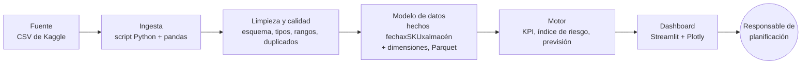

# Project brief: priorización de reposiciones en una red de almacenes

## 1. Resumen ejecutivo

Cada lunes, la herramienta indica a la responsable de planificación qué combinaciones producto-almacén revisar primero y por qué. No hace pedidos.

Hallazgos (datos de 2024):

| Hallazgo | Qué hacer |
|---|---|
| En primavera (febrero a mayo) se vende casi 3 veces más que en septiembre, pero el stock no sube, y ahí cae el 83 % de los días con riesgo. | Más margen de seguridad y revisiones antes de primavera. |
| De agosto a diciembre sobra stock, con más del 80 % de los registros de cada mes por encima del plazo + 14 días de cobertura. | Aplazar reposiciones en otoño y liberar capital. |
| El punto de pedido actual ignora el plazo del proveedor y no marca el 69 % de los días en que el stock no llega a cubrirlo, casi todos con plazos de 8 días o más. | Revisar primero esas combinaciones. |

Son resultados exploratorios, pendientes de las pruebas formales.

## 2. Dataset y calidad de los datos

### Ficha del dataset

| Campo | Información |
|---|---|
| Nombre | High-Dimensional Supply Chain Inventory Dataset |
| Publicador y enlace | Ziya07, Kaggle: https://www.kaggle.com/datasets/ziya07/high-dimensional-supply-chain-inventory-dataset |
| Licencia | CC0 1.0 Universal (dominio público): https://creativecommons.org/publicdomain/zero/1.0/ |
| Fecha de descarga y versión | Descargado el 13/10/2026. Kaggle no muestra fecha de última actualización e indica una frecuencia anual. |
| Qué representa una fila | Un registro por fecha, producto (`SKU_ID`) y almacén (`Warehouse_ID`). |
| Periodo | del 01/01/2024 al 30/12/2024. |
| Tamaño | 91.250 filas x 15 columnas; 6,55 MB. 50 SKU x 5 almacenes = 250 combinaciones, presentes todos los días (250 x 365 = 91.250). 10 proveedores y 4 regiones. |
| Columnas principales | Fecha: `Date`. Dimensiones: `SKU_ID`, `Warehouse_ID`, `Supplier_ID`, `Region`. Medidas: `Units_Sold`, `Inventory_Level`, `Supplier_Lead_Time_Days`, `Reorder_Point`, `Order_Quantity`, `Unit_Cost`, `Unit_Price`, `Demand_Forecast`. Indicadores: `Promotion_Flag`, `Stockout_Flag`. Objetivo candidato: `Units_Sold` (regresión). |
| Calidad observada | 0 % nulos; 0 duplicados; la clave fecha-SKU-almacén es única. Proveedor, plazo, `Reorder_Point` y coste son constantes por combinación. `Stockout_Flag` vale 0 en el 100 % de las filas. `Region` cambia de un día a otro dentro de la misma combinación (las 250 aparecen en las 4 regiones), así que no describe el almacén. El pronóstico (`Demand_Forecast`) de cada día tiene una correlación de 0,95 con las ventas de ese mismo día y de 0,61 con las del día anterior o siguiente. Unidades y moneda de `Unit_Cost` y `Unit_Price` sin documentar. No hay valores imposibles; los outliers por IQR (1,3 % de los días) y Mahalanobis (48 filas) se marcan, no se borran. |
| Otras fuentes | Ninguna unida en esta versión. Candidatas: (1) el calendario de promociones de Ventas, para revisar la reposición antes de cada promoción (H3); (2) los pedidos y recepciones del ERP, para medir plazos y roturas reales y validar H2. Se valoró el calendario de festivos de 2024 (BOE), pero se descartó: la venta media es la misma todos los días de la semana (entre 20,0 y 20,1 unidades). |

### Limitaciones y efecto en la decisión

- **Datos simulados.** Los 50 SKU comparten la misma curva estacional (correlación >= 0,99). Las cifras no se pueden extrapolar a una empresa real.
- **Un solo año.** No muestra si la estacionalidad se repite, así que la validación será temporal dentro de 2024.
- **Faltan datos operativos.** Sin pedidos pendientes, capacidad ni costes, la herramienta prioriza pero no calcula cantidades óptimas. En uso real haría falta el ERP.
- **Posible fuga en `Demand_Forecast`.** La correlación no la demuestra, pero no se usará en el bloque 3 hasta descartarla.

## 3. Problema empresarial

**Organización.** Distribuciones Sago Packaging, mayorista que abastece a comercios desde 5 almacenes, con 50 referencias y 10 proveedores.

**Estrategia.** La empresa quiere mantener el servicio sin aumentar el capital inmovilizado en stock. El proyecto lo apoya desde planificación, reponiendo solo cuando hace falta.

**Departamento.** Planificación de inventario, tres personas que deciden qué reponer en cada almacén.

**Stakeholder.** La responsable de planificación, que revisa el dashboard los lunes. Puede adelantar o aplazar pedidos, pedir transferencias entre almacenes y revisar con Ventas una promoción. No puede cambiar precios, proveedores ni capacidad.

**Decisión.** La responsable decidirá cada semana qué combinaciones revisar primero y qué reposiciones adelantar o aplazar.

**Restricciones.** Proyecto individual, sin ERP ni costes.

**Alternativas sin datos.** (1) Un Excel que avisa cuando `Inventory_Level` < `Reorder_Point`. Es barato, pero ignora el plazo y la estacionalidad. Será la **línea base** con la que se compara la herramienta (H2). (2) Recuentos físicos, que no anticipan nada.

**Efecto en otras áreas.**
- **Compras:** adelanta pedidos a proveedores de plazo largo antes de primavera.
- **Almacén:** más entradas en primavera y menos stock parado en otoño.
- **Finanzas:** menos capital inmovilizado de agosto a diciembre.
- **Ventas:** comparte con antelación el calendario de promociones.
- **Clientes:** menos pedidos incompletos en temporada alta.

## 4. Hipótesis

**Cobertura (días)** = `Inventory_Level` / venta media de esa combinación en los 28 días anteriores (mínimo 7). Si no es calculable, no cuenta. Los umbrales son propios del proyecto y salen de la exploración. Se probarán formalmente en las lecciones 03 a 05. Prioridad por valor: H2 > H1 > H3.

| | **H2 (prioridad alta)** | **H1 (prioridad alta)** | **H3 (prioridad media)** |
|---|---|---|---|
| Enunciado | El criterio cobertura < plazo prioriza casos distintos de la regla de `Reorder_Point`, que ignora el plazo (r = 0,03). | El riesgo se concentra en los meses de demanda alta: inventario y `Reorder_Point` no siguen la temporada. | Las promociones aumentan las ventas de forma relevante. |
| Métrica | % de registros con cobertura < plazo que la regla de `Reorder_Point` no marca. | % de registros en riesgo que caen entre febrero y mayo. | Uplift = media con promoción / media sin promoción - 1. |
| Dirección esperada | Más del 30 %, concentrado en combinaciones con plazo >= 8 días. | Más del 60 %. | Más del 15 %, estable entre meses. |
| Cómo se comprueba | Tabla cruzada de ambas reglas por proveedor y plazo. | Riesgo y demanda por mes, gráfico de líneas. | Medias con y sin promoción por SKU-almacén y mes; se excluyen las 151 combinaciones-mes sin ambos casos y se agrega por SKU-almacén (250 pares): mediana y % de pares positivos. |
| Si es cierta | El motor combina ambas reglas. Sin roturas reales (`Stockout_Flag` = 0) no se sabe cuál acierta más. | Más stock en primavera y menos en otoño. | Usar el calendario de promociones de Ventas para revisar antes la reposición. |
| Si es falsa | La regla de Excel basta: dashboard descriptivo. | Un margen único para todo el año. | No ajustar la reposición por promoción. |

En H3, la diferencia no prueba que la cause la promoción.

## 5. Indicadores del dashboard

| KPI | Fórmula | Grano | Comparación | Objetivo | Hipótesis |
|---|---|---|---|---|---|
| Demanda media diaria | Suma de `Units_Sold` / días (ventana de 28 días) | SKU-almacén, día | Almacén, mes | Contexto | H1 |
| % de registros en riesgo | Registros con cobertura < plazo / registros evaluados | Día | Almacén, proveedor | <= 2 % (actual: 3,7 %) | H2 |
| % de registros en banda | Registros con plazo <= cobertura <= plazo + 14 días / registros evaluados | Día | Almacén, mes | >= 70 % (actual: 41 %) | H1, H2 |
| % de registros bajo punto de pedido | Registros con `Inventory_Level` < `Reorder_Point` / registros evaluados | Día | Almacén | Línea base (actual: 5,3 %) | H2 |
| Uplift por promoción | Ver H3 | SKU-almacén, mes | Mes | Informa la previsión | H3 |
| Valor estimado del inventario (moneda sin verificar) | Suma de `Inventory_Level` x `Unit_Cost` | Almacén, semana | Mes | Bajar en meses de demanda baja sin subir el riesgo (exploratorio) | H1 |

Son porcentajes de registros diarios (89.500 con historia suficiente), agregados por semana en el dashboard, y se reproducen con `project/01_eda_inventario.ipynb`. Los objetivos buscan reducir el riesgo a la mitad y tener en banda a la mayoría.

**Trade-offs.** Subir la cobertura reduce el % en riesgo, pero aumenta el valor del inventario, por eso el dashboard los muestra juntos.

## 6. Solución y arquitectura

### Tipo de solución

Es una herramienta de apoyo a decisiones. Un motor calcula las prioridades y el dashboard las muestra.

- **Entradas:** el CSV de Kaggle y, en uso real, el ERP y el calendario de promociones.
- **Lógica:** para cada SKU-almacén, índice de riesgo = plazo / cobertura. Si pasa de 1, la combinación se marca para revisión, aunque eso no predice una rotura. En el bloque 3, una previsión estacional sin `Demand_Forecast` sustituirá a la media móvil.
- **Salidas:** un ranking semanal con las 20 combinaciones a revisar y su motivo, y la lista de sobrecubiertas.
- **Capa what-if:** al cambiar los días de margen se recalculan el ranking y un stock objetivo experimental, igual a demanda media x (plazo + margen).

### Arquitectura

| Capa | Qué hace en el proyecto | Herramienta | Actualización |
|---|---|---|---|
| Fuente | CSV original y fecha de descarga | Kaggle | Anual |
| Ingesta | Carga y registra versión y filas | Python, pandas | Con cada descarga |
| Limpieza y calidad | Contrato de ingesta; si falla, se detiene | pandas, pytest | En cada carga |
| Modelo de datos | Hechos (fecha x SKU x almacén) y dimensiones combinación y fecha | Parquet | Tras validar |
| Analítica / motor | KPI, índice de riesgo y, en el bloque 3, la previsión | Python, scikit-learn | Con datos o reglas nuevos |
| Dashboard | KPI, ranking semanal, detalle por SKU y promociones | Streamlit, Plotly | Al regenerar el motor |

**Responsable y refresco.** Lo mantengo yo manualmente con cada nueva versión. Si cambia el formato, las validaciones detienen el proceso.

**Dónde vive.** `data/`, `src/`, `tests/` y `project/` en mi repositorio.

**Riesgos principales.** (1) Los datos simulados son muy regulares y el modelo puede parecer mejor de lo que es. (2) Si cambia el formato o la licencia, queda la copia original. (3) Un aviso erróneo encarece el inventario o causa roturas, así que cada aviso se explica y lo revisa una persona.

**Por qué esta solución.** Un dashboard descriptivo no ordena prioridades y la regla de Excel ignora plazo y estacionalidad. Los pedidos automáticos se descartan por falta de costes.

**Aspectos legales y éticos.** No hay datos personales y la licencia CC0 permite publicar resultados. El dashboard indicará que los datos son simulados.

## 7. Fuentes

1. Ziya07, *High-Dimensional Supply Chain Inventory Dataset*, Kaggle: https://www.kaggle.com/datasets/ziya07/high-dimensional-supply-chain-inventory-dataset
2. Creative Commons, *CC0 1.0 Universal*: https://creativecommons.org/publicdomain/zero/1.0/

Todas las cifras proceden del CSV descargado el 13/10/2026.
